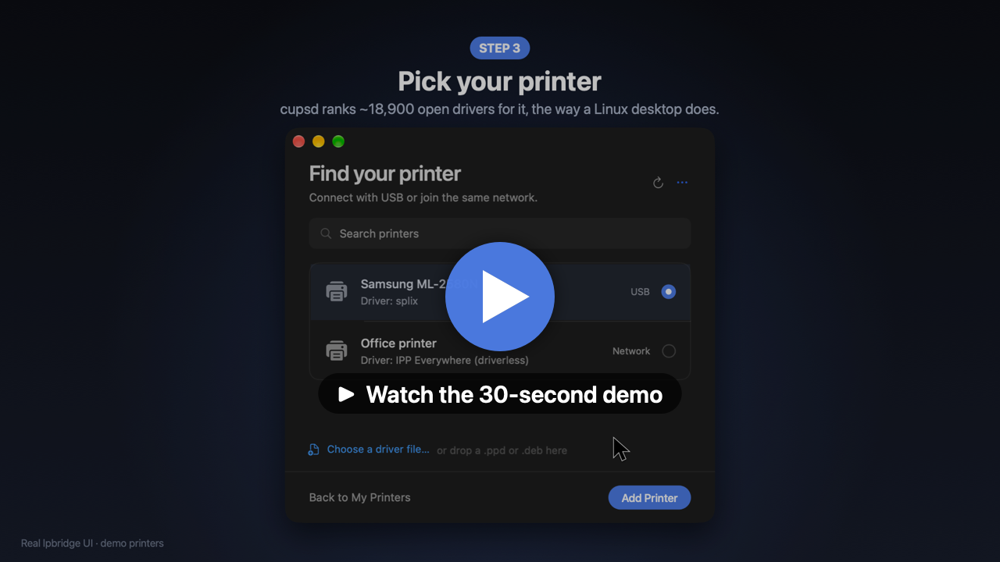

# lpbridge

> This project is heavily vibe-coded and I plan to refine and manually optimize
> the codebase in the future. I personally do not approve vibe-coding
> applications. This one however was created to stand for the consumer rights
> (if you once bought it you should be able to use it as long as it gets the
> job done for you) and to combat the issue of e-waste. Let the end justify
> current means. That being said any contribution to the project, any bug and
> vulnerability found is more than welcome.
>
> There are currently 2 known issues:
> 1. First scan takes 30 seconds to 1 minute -- long time and looks like
>    frozen -- keep waiting please.
> 2. Printer helpers appear in the system as printers for some types of
>    drivers -- unresolved.

lpbridge makes printers that only have a Linux driver work on Apple Silicon
Macs, as normal printers you print to with Cmd-P.

[](docs/media/lpbridge-demo.mp4)

*30-second demo ([MP4](docs/media/lpbridge-demo.mp4)): the real lpbridge app
with sample printers. The macOS Print dialog is a mock-up.*

## Features

- **Connects printers macOS can't.** Runs the Linux driver for printers whose
  vendor never shipped a macOS driver, or shipped one only for Intel Macs.
  Works with arm64 Linux drivers and with x86-64 / 32-bit x86 ones.
- **Feels native.** Once set up, the printer appears in System Settings and in
  every app's Print dialog with its real paper sizes, trays, duplex and colour
  options. Job status shows up in the normal macOS print queue.
- **Future-proof.** Does not use Rosetta 2 (Apple removes it in macOS 28) and
  does not use macOS printer drivers or PPDs, which Apple deprecated in favour
  of driverless IPP Everywhere / AirPrint. macOS only ever sees a standard IPP
  Everywhere printer; the real driver runs in a Linux engine, with x86 drivers
  translated by FEX / QEMU instead of Rosetta.
- **No per-printer driver hacking.** As macOS moves to IPP Everywhere, the
  usual workaround -- patching or hand-writing a macOS driver for one
  particular printer -- stops working. lpbridge doesn't patch anything: it runs
  Ubuntu's complete, unmodified open driver collection (about 18,900 printer
  models: Gutenprint, HPLIP, foo2zjs, SpliX, brlaser, ...) and picks the driver
  the same way a Linux desktop does. You can also drop in a vendor `.ppd` or
  `.deb`.
- **Saves battery.** The Linux engine starts only when you print and shuts
  itself down a couple of minutes after the last job. Nothing runs in the
  background between jobs.
- **Power-user access.** *Open Engine Terminal…* in the app gives you a root
  shell in the Linux engine for vendor installers or debugging. Files placed in
  the app's *Transfer* folder appear there as `/spool/transfer`.

USB and network printers are both supported.

## Requirements

- Mac with Apple Silicon (M1 or newer)
- macOS 13 Ventura or newer
- Internet connection for the build
- About 12 GB of free disk space for the build (about 4 GB once installed)
- 20–40 minutes for the first build

## Build, sign and install

Open Terminal and run:

```sh
git clone https://github.com/karol-domosud/lpbridge.git
```

```sh
cd lpbridge
```

```sh
tools/bootstrap.sh
```

That one script does everything:

1. Installs Apple's Command Line Tools if missing (a system installer window
   opens -- click *Install* and wait).
2. Installs Podman if missing (via Homebrew if you have it, otherwise the
   official installer opens). Podman is only used to build; the installed app
   does not need it.
3. Builds the Linux print engine from a pinned, verified Ubuntu snapshot.
4. Compiles the app, **signs it locally** (ad-hoc `codesign`, no Apple
   Developer account needed) and copies it to `/Applications`.

Because the app is built and signed on your own Mac, it is not quarantined and
opens normally. No notarization is needed. If macOS still blocks it, go to
**System Settings → Privacy & Security → Open Anyway**.

If the script stops (network drop, installer closed), run it again -- it
continues where it left off. The full log is in `build/bootstrap.log`.

Other options:

```sh
tools/bootstrap.sh --dmg          # build build/lpbridge-<version>-arm64.dmg instead of installing
```

```sh
tools/bootstrap.sh --rebuild      # rebuild the engine and the app from scratch
```

## Use

1. Open **lpbridge** from Applications.
2. Click **Set Up My Printer**. The first scan takes up to a minute (see known
   issues).
3. Pick your printer and its driver (the recommended one is preselected).
4. Print from any app with Cmd-P.

Add more printers under **Your printers**. Printing keeps working after you
close the app and after a restart.

## Uninstall

Quit the app, then:

```sh
launchctl bootout gui/$(id -u)/com.lpbridge.app.agent; rm -f ~/Library/LaunchAgents/com.lpbridge.app.agent.plist
```

```sh
rm -rf /Applications/lpbridge.app ~/Library/Application\ Support/lpbridge
```

Remove the lpbridge printers in **System Settings → Printers & Scanners**.

## Contributing

Bugs, vulnerabilities and pull requests are welcome via GitHub issues.
Developer documentation: [DEVELOPING.md](DEVELOPING.md),
[docs/API.md](docs/API.md).

## License

GPL-3.0-or-later, see [LICENSE](LICENSE). The bundled Linux engine contains
separately licensed software (CUPS, Ghostscript, OpenPrinting drivers,
Ubuntu); see [SOURCES.md](SOURCES.md) and
[packaging/THIRD-PARTY.md](packaging/THIRD-PARTY.md). lpbridge is not an
Ubuntu or Canonical product.

App icon: ["Print"](https://www.svgrepo.com/svg/331557/print) by
[Jo Szczepanska](https://www.svgrepo.com/author/Jo%20Szczepanska/)
(svgrepo.com), [CC BY-NC 4.0](https://creativecommons.org/licenses/by-nc/4.0/),
recoloured. It is licensed separately from the code: commercial
redistributors must replace it.
